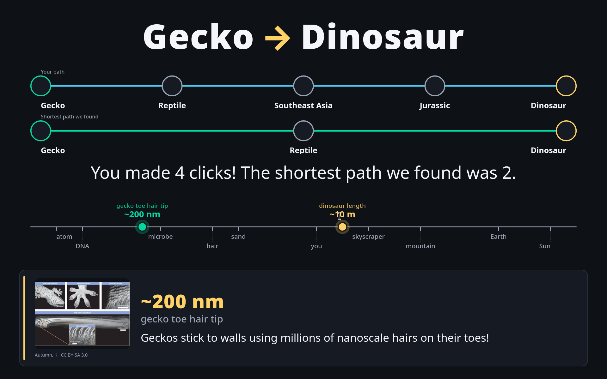
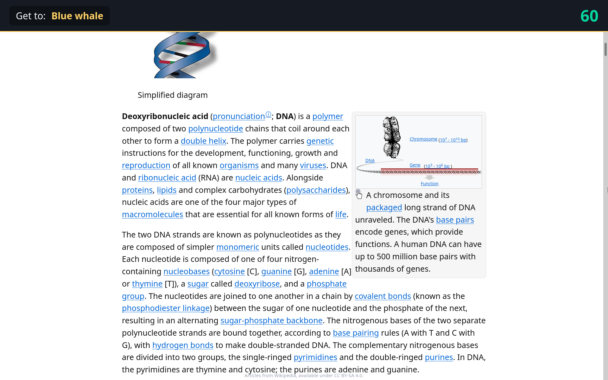
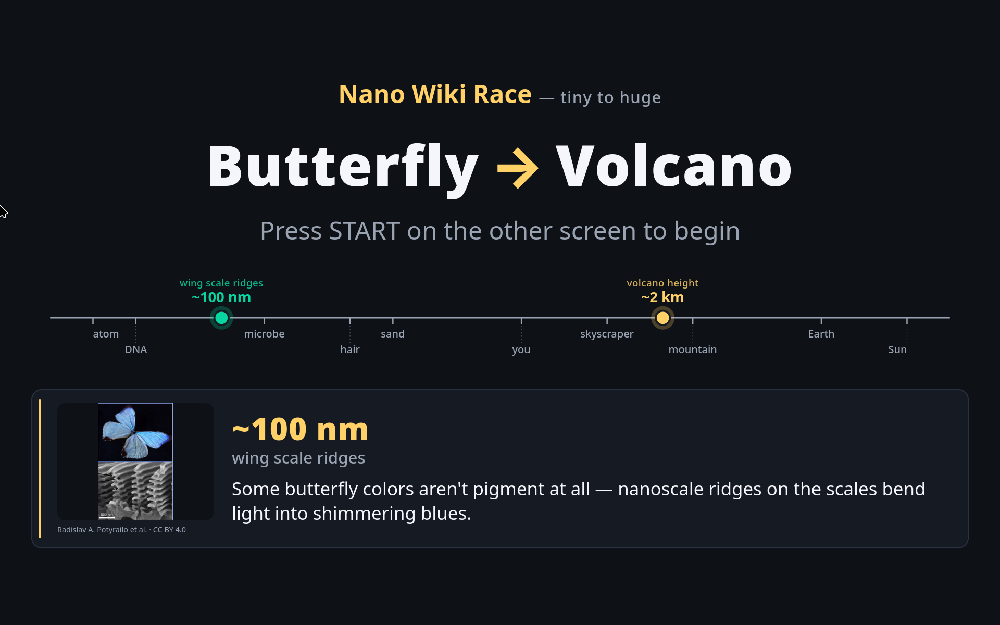

# Nano Wiki Race

A small, zero-install demo for **Nano Day** (October 9, since 10/9 reads
as 10⁻⁹, the nanometer). A kid starts on a nano-scale Wikipedia article
and tries to click their way to a much bigger target (e.g. *Gecko →
Dinosaur*, *Graphene → Sun*). When the round ends, an info screen shows
the kid's path next to the shortest path found in a knowledge graph.

## Background

I built this for Nano Day at the Richmond Science Museum. My university's NLP lab collaborates with our Nano lab, and we run an outreach table at this event together. Kids
come to this demo for the candy but ultimately have fun with the wiki race. Running the table is also a day of moving chairs around with lab members and talking about things that aren't research, which is essentially free team building.

## Design

This is a station that moves a line of kids. We bribe
them with candy. Along the way they pick up a bit about nanomaterials
and how to navigate Wikipedia. A round takes about 2 minutes (3 s
countdown + 120 s play + 5 s reveal). Not a competitive game; everyone
gets candy.

**Adult supervision required.** Wikipedia has pages that aren't
appropriate for every age, and the kid picks every click.

## Screenshots

The reveal: the kid's path vs. the computer's shortest, with the scale bar
underneath.



Player view mid-round: a Wikipedia article under a countdown, with the
current target in the header.



Between rounds, with the fact card and scale bar.



## Setup (demo day)

1. Double-click `player.html`. It opens in your default browser.
2. On the player page, click **"Open info screen"**. A second window opens;
   drag it to your second monitor.
3. Press **F11** on both windows for fullscreen.
4. If the info-screen window gets closed or lost, press **D** on the player
   page to reopen it.

If pop-ups are blocked, allow pop-ups for this page and press **D** again.

## Controls

- **Space** or **Enter**: start the round (works with a USB arcade button
  that sends a keystroke).
- **N**: skip to the next pair.
- **D**: reopen the info-screen window.

## File layout

```
nano-wiki-race/
├── player.html         kid's screen
├── display.html        info screen
├── config.js           timings, wiki host
├── pairs.js            challenges + shortest paths
├── style.css           shared styles
├── wiki.js             fetch + clean an article, title normalization
├── player.js           game loop
├── display.js          info screen renderer
├── images/             bundled fact-card images (CC BY-SA 3.0)
├── tools/
│   ├── find-paths.html path finder (one-time, pre-event)
│   └── find-paths.js
├── screenshots/        README images
└── README.md
```

No build step, no npm, no backend. It runs by double-clicking `player.html`.
Chrome/Chromium and Firefox are tested.

## Making a real `pairs.js`

The repo ships with a handful of plausible pairs so the demo runs
immediately. Before the event, generate a verified list:

1. Open `tools/find-paths.html` in a browser.
2. Edit the start and target lists (seeds are pre-filled). Keep paths short:
   2 clicks is ideal, 3 is the ceiling.
3. Click **Search**. Watch the status panel. This can take a few minutes,
   so be polite to Wikipedia and keep concurrency at 2.
4. Review the table. Uncheck pairs that look weird or dull. For the ones
   you keep, fill in the nano fact, emoji, size, and scale-label columns.
   These feed the fact card and scale bar on the info screen.
5. Click **Download pairs.js** and drop it in next to `player.html`,
   replacing the shipped stub.
6. Open the new `pairs.js` and hand-add the fields the tool doesn't
   capture: the numeric sizes (`startMeters`, `targetMeters`, `targetSize`,
   `targetLabel`) that place dots on the scale bar, and the image +
   attribution fields (`image`, `imagePage`, `imageAuthor`,
   `imageLicense`). The full field list lives in the comment block at the
   top of `pairs.js`.

## Troubleshooting

- **Pop-up blocked**: allow pop-ups for this page, press **D**.
- **Info screen window closed or lost**: press **D** on the player page.
- **Wi-Fi slow**: the timer keeps running; the kid just gets "Loading…"
  briefly, then a fresh page. The round is still fun.
- **Can't reach any article**: check that Wikipedia loads normally in a new
  tab; the whole thing depends on `en.wikipedia.org/w/api.php?origin=*`.

## Developer notes

To iterate on the reveal without playing a round, open
`display.html?preview=win` (or `match`, or `timeout`) in a browser. Add
`&len=N` to set the kid's path length (default 7). The scenario uses
whichever pair is first in `pairs.js`.

## Attribution

Articles are fetched live from Wikipedia and are available under
[CC BY-SA 4.0](https://creativecommons.org/licenses/by-sa/4.0/). This is
noted in the player footer. Nothing about the kids is stored.

The fact-card images under `images/` are redistributed from Wikimedia Commons
under [CC BY-SA 3.0](https://creativecommons.org/licenses/by-sa/3.0/); each
pair carries `imagePage` / `imageAuthor` / `imageLicense` fields which the
info screen renders as a credit line on the card. If you swap in your own
images, keep those fields filled in so attribution stays visible.
